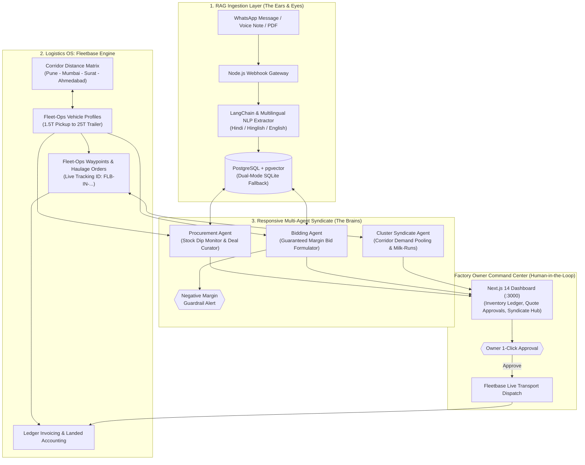

# 🏭 BarterForge — Smart Factory Syndicate

> **Autonomous Digital Procurement, Dynamic Landed-Cost Bidding & Fleetbase Logistics OS for SME Manufacturers.**  
> *Engineered to solve Problem Statement 4.1: Eradicating raw material overpayment and quote losses via Agentic AI & Logistics Optimization.*

[](https://opensource.org/licenses/MIT)
[](https://github.com/Yug-the-pirate-king/BarterForge)
[](https://fleetbase.io)
[](https://fastapi.tiangolo.com)
[](https://nextjs.org)
[](https://github.com/pgvector/pgvector)

---

## 📌 Executive Summary & Problem Statement 4.1

Small-to-medium enterprise (SME) factories in manufacturing hubs (such as the Pune, Chakan, Pimpri, and Bhosari industrial corridors) suffer from two chronic supply chain vulnerabilities:

1. **Raw Material Overpayment (10%–20% Loss):**  
   Procurement happens through fragmented, informal WhatsApp chats, voice notes, and phone calls. Factory owners compare unstructured quotes manually across a limited vendor circle, missing prevailing mill prices and regional spot discounts.
2. **Quoting Orders at a Loss (Uncalculated Landed Costs):**  
   When quoting buyer RFQs, owners use rule-of-thumb guesswork for material costs while neglecting dynamic transportation fees, toll surcharges, vehicle tonnage variations, and terminal handling expenses.

**BarterForge (Smart Factory Syndicate)** resolves this by combining **Fleetbase Logistics OS**, **LangChain Multilingual RAG Ingestion**, and **Responsive Multi-Agent Clusters** with a strict **Human-in-the-Loop** approval philosophy.

---

## 🏛️ System Architecture

```text
┌────────────────────────────────────────────────────────────────────────────────────────────────────────┐
│                                   BARTERFORGE / SMART FACTORY SYNDICATE                                │
├──────────────────────────┬─────────────────────────────┬───────────────────────────────────────────────┤
│ 1. LOGISTICS OS          │ 2. RAG & INGESTION          │ 3. RESPONSIVE MULTI-AGENT CLUSTERS            │
│    (Fleetbase API)       │    (LangChain / NLP)        │    (Autonomous Reasoning with Human-in-Loop)  │
├──────────────────────────┼─────────────────────────────┼───────────────────────────────────────────────┤
│ • Fleet-Ops Waypoints    │ • Hinglish WhatsApp parser  │ • Autonomous Procurement Agent                │
│ • Live Corridor Matrices │ • Pydantic Schema Guards    │   (Stock dip monitor -> Top 3 sourcing deals) │
│ • 4-Tier Vehicle Profiles│ • Dynamic Landed Cost Calc  │ • Landed-Cost Bidding Agent                   │
│   (1.5T to 25T)          │ • Ingestion Studio UI       │   (RFQ Landed Cost + Negative Margin Guard)   │
│ • Ledger Invoicing       │ • WhatsApp Cloud / Twilio   │ • Cluster Syndicate Demand Pooling Agent      │
│ • Multi-Drop Milk-Runs   │   Webhook Gateway (Node.js) │   (Multi-factory bulk mill pooling & routes)  │
└──────────────────────────┴─────────────────────────────┴───────────────────────────────────────────────┘
```

---

## 🧭 Data Flow & Agentic Decision Pipeline



---

## ⚡ The 4 Core Pillars

### 1. 🛰️ Logistics OS (Fleetbase Fleet-Ops Integration)
- **Indian Industrial Corridor Distance Matrix:** Calibrated transit corridors covering Mumbai, Navi Mumbai, Thane, Nashik, Aurangabad, Kolhapur, Ahmedabad, Surat, and Pune MIDC.
- **4 Transport Tiers:**
  - *Tata Ace / Mahindra Bolero Pickup (1.5 MT)* — ₹22.0/km (Local quick runs)
  - *Eicher Pro 1110 (5.0 MT)* — ₹32.0/km (Mid-weight inter-city)
  - *Ashok Leyland 1618 Multi-Axle (10.0 MT)* — ₹45.0/km (Primary standard trucks)
  - *BharatBenz 4028T Heavy Trailer (25.0 MT)* — ₹75.0/km (Bulk mill coils & milk-runs)
- **True Landed Cost Formula:**
  $$\text{True Landed Cost} = \text{Material Base Price} + \text{Fleetbase Freight} + \text{Tolls \& Terminal Handling}$$

### 2. 👂 RAG Ingestion Studio & Multilingual NLP
- Parses informal, multilingual supplier communications (English, Hindi, Hinglish, regional trade jargon).
- Example input:
  > *"Namaste Sharma ji, Tata CRCA 1.2mm fresh coils @ ₹67,800/MT ex-Navi Mumbai yard. 12 MT ready stock available. Delivery extra approx ₹8,500. Payment 30 days."*
- Resolves material name, SKU match (`RAW-STL-001`), base price, quantity, unit, delivery terms (*ex-plant* vs *FOR doorstep*), and lead time.
- Fallback currency-first regex parser guarantees 100% test pass even without live OpenAI API keys.

### 3. 🧠 Multi-Agent Procurement & Bidding with Loss Guardrails
- **Autonomous Procurement Agent:** Continuously scans inventory levels. Upon detecting a deficit below safety thresholds, it evaluates all available quotes and ranks the **Top 3 Sourcing Strategies**:
  1. *Option A: Best Landed Cost & Value*
  2. *Option B: Fastest Delivery for Critical Stock*
  3. *Option C: Verified High-Reliability Local Vendor*
- **Landed-Cost Bidding Agent:** Dynamically formulates customer quotations:
  $$\text{Bid} = \text{Material Cost} + \text{In-House Processing Overhead} + \text{Fleetbase Transport} + \text{Owner's Margin}$$
- **Negative Margin Guardrail:** If a buyer's target price causes a net loss after logistics and overhead, the agent **blocks the bid**, issues a high-priority warning, and calculates the exact minimum safe break-even price.

### 4. 🤝 Responsive AI Clusters (Syndicate Demand Pooling)
- **Geographic Clustering:** Maps neighboring factories within a 30 km radius (e.g. Pune, Pimpri, Chakan, Bhosari).
- **Demand Pooling:** Aggregates raw material demand (e.g. 42 MT pooled out of 50 MT target for CRCA Mild Steel Sheet).
- **Direct Mill Bulk Rates:** Bypasses middleman markups to secure primary mill rates directly from Tata Steel / JSW, unlocking **10.65% direct material savings (₹306,600 on 42 MT)**.
- **Fleetbase Multi-Stop Milk-Runs:** Consolidates 3 individual truck deliveries into a single 25-Ton BharatBenz trailer run, slashing freight from ₹34,868 to ₹19,350 (**44.5% freight savings = ₹15,518**).
- **Total Combined Syndicate Savings:** **₹322,118.00** on a single consolidated run.

---

## 📊 Comprehensive Phased Roadmap Status

| Phase | Milestone Name | Status | Verification Result | Fleetbase Engine Modules Leveraged |
| :--- | :--- | :---: | :---: | :--- |
| **Phase 1** | **Core Platform & Infrastructure** | 🟢 **100% COMPLETE** | Verified | `fleetops` (Places, Vendors, Routing), `ledger` (Cost tracking) |
| **Phase 2** | **RAG Pipeline & Data Ingestion** | 🟢 **100% COMPLETE** | Verified | `api` (Webhooks), `fleetops` (Freight auto-calc per quote) |
| **Phase 3** | **Multi-Agent Procurement & Bidding** | 🟢 **100% COMPLETE** | Verified | `fleetops` (Live dispatch orders, Waypoints, Tracking IDs) |
| **Phase 4** | **Responsive AI Clusters (Syndicate)** | 🟢 **100% COMPLETE** | Verified | `fleetops` (Multi-stop Milk-Run routing), `pallet` (Shared loads) |

---

## 🌐 Application Portals & UI Hubs

| Screen | URL | Purpose |
| :--- | :--- | :--- |
| **Owner Command Center** | `http://localhost:3000/` | Real-time Inventory Asset Value, Safety Stock Alerts, and Landed Cost Calculator |
| **Cluster Syndicate Hub** | `http://localhost:3000/syndicate` | Active Demand Pooling Progress, Milk-Run Route Visualizer & 1-Click PO Execution |
| **AI Agents Operations Hub** | `http://localhost:3000/agents` | Procurement Strategy Deals & Bidding Formulator with Negative Margin Guardrails |
| **RAG Ingestion Studio** | `http://localhost:3000/ingest` | Paste unstructured WhatsApp/SMS quotes and view real-time NLP extraction |
| **Fleetbase Logistics Command** | `http://localhost:3000/fleetbase` | Corridor Route Simulator, Vehicle Fleet Profiles & Dispatched Waypoint Orders |
| **Raw Material Ledger** | `http://localhost:3000/inventory` | Live SKU ledger, safety threshold tracking, and reorder triggers |
| **FastAPI Swagger API Docs** | `http://localhost:8000/docs` | Interactive OpenAPI documentation for all 25+ REST endpoints |

---

## ⚡ Quickstart Guide

### 1. Prerequisites
- **Python 3.10+**
- **Node.js 18+** & npm
- **Docker & Docker Compose** (Optional — resilient dual-mode SQLite fallback included)

### 2. Launching via 1-Click Windows Batch Script
Simply double-click the launcher script in the repository root:
```cmd
START_SMART_FACTORY.bat
```
*This automatically starts the FastAPI AI backend (:8000), starts the Next.js frontend (:3000), and opens the dashboard in your default browser.*

To stop all background processes cleanly:
```cmd
STOP_SMART_FACTORY.bat
```

### 3. Launching via Terminal Manually

#### Step A: Start the AI Backend (FastAPI)
```bash
cd smart-factory-syndicate/backend_ai
pip install -r requirements.txt
python -m uvicorn main:app --reload --host 127.0.0.1 --port 8000
```
Swagger API docs will be live at `http://localhost:8000/docs`.

#### Step B: Start the Next.js Frontend
```bash
cd smart-factory-syndicate/frontend
npm install
npm run dev
```
Open `http://localhost:3000` in your browser.

---

## 🧪 Automated Verification Test Suites

The platform includes 4 automated verification suites testing each phase end-to-end:

```bash
cd smart-factory-syndicate/backend_ai

# 1. Tests Fleetbase vehicle profiles, routing distance matrix, and Fleet-Ops order dispatch
python verify_fleetbase.py

# 2. Tests Procurement deal ranking and Bidding negative margin guardrail protection
python verify_agents.py

# 3. Tests Corridor demand pooling, primary mill bulk discounts, and milk-run routing
python verify_syndicate.py

# 4. Runs the comprehensive master walkthrough simulating the complete factory owner journey
python demo_walkthrough.py
```

---

## 📁 Repository Directory Structure

```text
BarterForge/
├── README.md                      # Primary project documentation & architecture
├── .gitignore                     # Production Git rules (node_modules, .next, __pycache__)
├── START_SMART_FACTORY.bat        # 1-Click Windows launcher
├── STOP_SMART_FACTORY.bat         # 1-Click Windows shutdown
│
└── smart-factory-syndicate/        # Main application monorepo
    ├── PROJECT_BOARD.md           # Engineering Project Board & Detailed Sprints
    ├── docker-compose.yml         # Containerized Postgres+pgvector & Redis stack
    ├── .env.example               # Environment variables template
    │
    ├── backend_ai/                # Python FastAPI Backend & Multi-Agent Logic
    │   ├── app/
    │   │   ├── config.py          # App settings & API URLs
    │   │   ├── database.py        # Dual-mode engine (PostgreSQL + SQLite fallback)
    │   │   ├── models.py          # SQLAlchemy models (Factories, Suppliers, Inventory, Quotes, Pools)
    │   │   ├── schemas.py         # Pydantic validation schemas
    │   │   ├── seed.py            # SME seed dataset (5 commodities, 4 suppliers, corridor cluster)
    │   │   ├── services/
    │   │   │   ├── fleetbase_service.py   # Fleetbase Fleet-Ops & distance matrix
    │   │   │   ├── extraction_service.py  # LangChain / NLP quote extractor
    │   │   │   ├── procurement_agent.py   # Stock scanner & Top-3 deal curator
    │   │   │   ├── bidding_agent.py       # RFQ responder & margin guardrails
    │   │   │   └── cluster_agent.py       # Demand pooling & milk-run routing
    │   │   └── routes/
    │   │       ├── dashboard.py   # KPIs & asset valuations
    │   │       ├── inventory.py   # Stock ledger endpoints
    │   │       ├── quotes.py      # Quote extraction & approval queue
    │   │       ├── suppliers.py   # Supplier directory endpoints
    │   │       ├── fleetbase.py   # Fleet-Ops dispatch & corridor routes
    │   │       ├── agents.py      # Multi-Agent control endpoints
    │   │       └── syndicate.py   # Demand pools & milk-run dispatch
    │   ├── main.py                # FastAPI entrypoint with CORS & auto-seed
    │   ├── verify_fleetbase.py    # Fleetbase test suite
    │   ├── verify_agents.py       # Agent test suite
    │   ├── verify_syndicate.py    # Syndicate test suite
    │   └── demo_walkthrough.py    # Master end-to-end journey runner
    │
    ├── frontend/                  # Next.js 14 Factory Owner Command Center
    │   ├── src/app/
    │   │   ├── page.tsx           # Owner Command Dashboard
    │   │   ├── syndicate/page.tsx # Responsive AI Syndicate Hub
    │   │   ├── agents/page.tsx    # Multi-Agent Operations Hub
    │   │   ├── ingest/page.tsx    # RAG Ingestion Studio
    │   │   ├── fleetbase/page.tsx # Fleetbase Logistics Hub
    │   │   ├── inventory/page.tsx # Raw Material Inventory Ledger
    │   │   └── quotes/page.tsx    # Quote Approval Decision Center
    │   ├── src/components/        # UI components (MetricCard, InventoryTable, Sidebar, Modals)
    │   └── src/lib/               # API clients and TypeScript definitions
    │
    ├── backend_gateway/           # Node.js Webhook Gateway
    │   ├── index.js               # WhatsApp Cloud API & Twilio webhook listener
    │   └── package.json
    │
    └── fleetbase_engine/          # Fleetbase Logistics Engine Integration
        ├── FLEETBASE_INTEGRATION_GUIDE.md # Webhook specs & payload references
        ├── corridor_rates.json           # Calibrated industrial corridor rate matrix
        └── docker-compose.fleetbase.yml  # Standalone Fleetbase Docker services
```

---

## 🛡️ Human-in-the-Loop Philosophy
The AI system never executes transactions autonomously without bounded limits. The agents compute, rank, formulate, and flag risks; the **human factory owner retains 1-click approval authority** over all purchase orders and outgoing bids.

## 📄 License
This project is licensed under the [MIT License](LICENSE).

