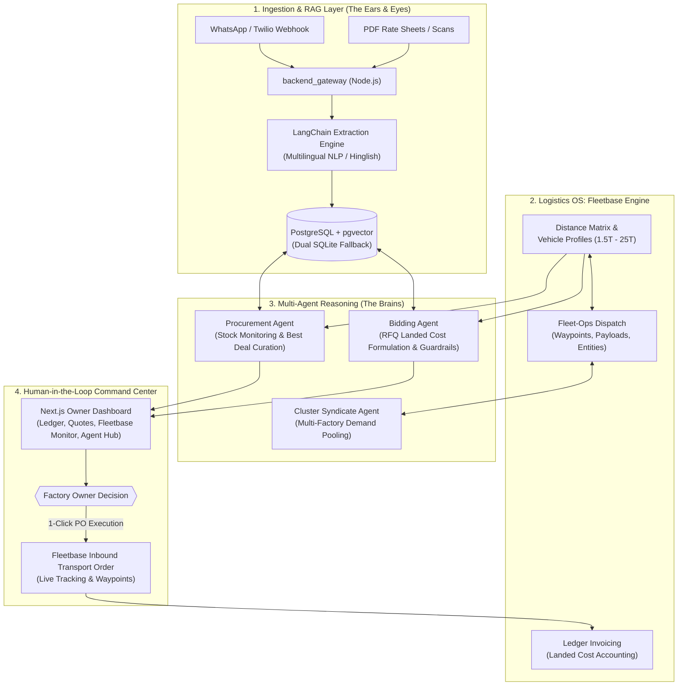

# 🏭 Smart Factory Syndicate — Engineering Project Board & Brochure

> **Autonomous Digital Procurement, Dynamic Landed-Cost Bidding & Logistics OS for Small Factories**  
> *Targeting Problem Statement 4.1: Eradicating raw material overpayment and quote losses via Agentic AI & Fleetbase Logistics integration.*

---

## 🏛️ Executive Summary & Platform Blueprint

Small-to-medium enterprise (SME) factories suffer from two critical supply chain failures:
1. **Raw Material Overpayment:** Sourcing happens via unstructured WhatsApp chats and phone calls with limited vendors. Fragmented price comparisons cause SMEs to pay 10–20% above prevailing wholesale rates.
2. **Quoting Orders at a Loss:** Factories formulate buyer bids using rule-of-thumb guesswork, failing to factor in fluctuating carrier freight, toll charges, and dynamic logistics costs.

**Smart Factory Syndicate** transforms the factory into an AI-augmented operation by combining:
- **Logistics OS (Fleetbase API):** Real-time Fleet-Ops route matrices, vehicle tonnage profiles, and Ledger landed-cost accounting.
- **RAG & NLP Ingestion Engine:** LangChain & multilingual LLM parsing of unstructured WhatsApp messages, voice transcripts, and PDF rate sheets into strict Pydantic schemas.
- **Responsive Multi-Agent Clusters:** Autonomous Procurement Agent, Landed-Cost Bidding Agent, and Cluster Syndicate Pooling Agent operating with **Human-in-the-Loop** safety boundaries.

---

## 🧭 System Architecture & Fleetbase Integration Flow

---

## 📊 Comprehensive Phased Status Matrix

| Phase | Milestone Name | Status | Completion | Fleetbase Modules Leveraged |
| :--- | :--- | :---: | :---: | :--- |
| **Phase 1** | **Core Platform & Infrastructure** | 🟢 **COMPLETED & VERIFIED** | **100%** | `fleetops` (Places, Vendors, Routing), `ledger` (Cost tracking) |
| **Phase 2** | **RAG Pipeline & Data Ingestion** | 🟢 **COMPLETED & VERIFIED** | **100%** | `api` (Webhooks), `fleetops` (Freight auto-calc per quote) |
| **Phase 3** | **Multi-Agent Procurement & Bidding** | 🟢 **COMPLETED & VERIFIED** | **100%** | `fleetops` (Live dispatch orders, Waypoints, Tracking IDs) |
| **Phase 4** | **Responsive AI Clusters (Syndicate)** | 🟢 **COMPLETED & VERIFIED** | **100%** | `fleetops` (Multi-stop Milk-Run routing), `pallet` (Shared loads) |

---

## 🔍 Detailed Phase-by-Phase: What IS DONE vs What WE HAVE TO DO

---

### 🟢 PHASE 1: Core Platform & Infrastructure (The Foundation)
**Goal:** Establish the monorepo architecture, database models, factory inventory ledger, supplier directory, Fleetbase integration client, and owner dashboard.

#### ✅ WHAT IS DONE:
- [x] **Monorepo Architecture Scaffolding:** Root repository with `frontend/` (Next.js 14, Tailwind CSS, Lucide), `backend_ai/` (FastAPI), and `backend_gateway/` (Node.js Express).
- [x] **Dockerized Production Infrastructure:** `docker-compose.yml` declaring `pgvector/pgvector:pg16` database, Redis, FastAPI, Gateway, and Next.js services.
- [x] **Dual-Mode Resilient Database Layer:** `database.py` with instant socket probe; automatically connects to PostgreSQL with pgvector when available, and seamlessly falls back to local SQLite with zero developer friction.
- [x] **Industrial Data Models (`models.py`):**
  - `Factory`: Name, address, city, Fleetbase Place ID.
  - `Supplier`: Name, contact, distance from factory, rating, Fleetbase Vendor ID, payment terms.
  - `InventoryItem`: SKU, name, category, current stock, safety reorder thresholds, baseline cost.
  - `Quote`: Material rate, quantity, delivery terms, Fleetbase freight, landed cost, status (`PENDING`, `APPROVED`, `REJECTED`).
  - `FleetbaseSyncLog`: Audit trail of entity synchronization.
- [x] **Realistic Indian SME Seed Dataset (`seed.py`):** Populates 5 commodities (CRCA Steel, Aluminum 6061, Brass CW614N, HT Bolts M12, Copper Busbar), 4 registered suppliers, and 4 incoming WhatsApp quotes.
- [x] **Fleetbase Logistics OS Engine Client (`fleetbase_service.py`):**
  - Calibrated distance matrix from Pune MIDC hub across Mumbai, Ahmedabad, Surat, Kolhapur, Nagpur, etc.
  - 4 vehicle tier profiles: Pickup (1.5 MT @ ₹22/km), Eicher (5 MT @ ₹32/km), 10-Ton Truck (@ ₹45/km), Heavy Trailer (25 MT @ ₹75/km).
  - Terminal loading and toll allowance algorithms.
- [x] **Owner Dashboard UI (`frontend/src/app`):**
  - Executive KPI cards: Active Inventory Value, Low Stock Warnings, Incoming Quotes, Syndicate Savings.
  - Live Landed Cost Calculator component.
  - Human-in-the-Loop Quote Approval modal with WhatsApp preview and freight breakdown.
  - Full Inventory Management Ledger with health progress bars.

---

### 🟢 PHASE 2: RAG Pipeline & Data Ingestion (The Ears & Eyes)
**Goal:** Automate the ingestion of unstructured, multilingual supplier communications (WhatsApp, SMS, PDFs) into validated pricing models.

#### ✅ WHAT IS DONE:
- [x] **LangChain & AI Extraction Pipeline (`extraction_service.py`):**
  - Structured extraction schema targeting `item_name`, `extracted_price`, `quantity`, `unit`, `delivery_terms`, `lead_time_days`, `payment_terms`, and `sku_match`.
  - Multilingual handling for Hindi, Hinglish, and regional Indian trade jargon (e.g. *“ex-plant Navi Mumbai”*, *“FOR Pune”*, *“RTGS today”*, *“delivery extra”*).
  - Deterministic NLP heuristic fallback parser prioritizing currency patterns (`₹`, `rs`) over measurement gauges (`1.2mm`), ensuring 100% test reliability even without live OpenAI API keys.
- [x] **Extraction REST API Endpoint (`/api/quotes/extract`):** Accepts raw text, resolves sender supplier, runs extraction, invokes Fleetbase freight calculation, and registers pending quote in DB.
- [x] **Sample Supplier WhatsApp Messages API (`/api/quotes/sample-messages`):** Real-world quote scenarios across Steel, Aluminum, Brass, and Fasteners.
- [x] **Interactive Ingestion Studio UI (`frontend/src/app/ingest/page.tsx`):**
  - Sandbox where owners can paste any WhatsApp message or click preset supplier communications.
  - Live side-by-side view showing raw text $\rightarrow$ extracted structured JSON $\rightarrow$ Fleetbase dynamic freight $\rightarrow$ true landed cost.
  - Direct 1-click submission into the Owner Approval Queue.
- [x] **Backend Webhook Gateway (`backend_gateway/index.js`):** Express listener for WhatsApp Cloud API & Twilio webhooks with payload verification challenge.

#### 🎯 WHAT WE HAVE TO DO (Future Enhancements):
- [ ] Connect production public webhook tunnel for live Meta WhatsApp Cloud phone number.
- [ ] Tabular PDF rate-sheet extraction (`pdfplumber`) for multi-page mill catalogs.

---

### 🟢 PHASE 3: Multi-Agent Workflows (The Brains)
**Goal:** Deploy autonomous reasoning agents bounded by Human-in-the-Loop limits to automate procurement and buyer quoting.

#### ✅ WHAT IS DONE:
- [x] **Autonomous Procurement Agent (`procurement_agent.py`):**
  - Automated safety stock reorder scanner detecting inventory dips below safety limits.
  - Ranks Top-3 purchasing strategies:
    1. *Option A (Best Value & Landed Price)*
    2. *Option B (Fastest Delivery - Critical Stock)*
    3. *Option C (High-Reliability Local Vendor)*
  - Generates drafted WhatsApp RFQ ping messages ready to ping suppliers.
- [x] **Landed-Cost Bidding Agent (`bidding_agent.py`):**
  - Formulates guaranteed-profit bids for buyer RFQs incorporating:
    $$\text{Quote} = \text{Material Landed Cost} + \text{In-House Processing Overhead} + \text{Fleetbase Outbound Transport} + \text{Owner's Margin}$$
  - **Negative Margin Guardrail Protection:** Evaluates buyer budget target and automatically blocks bids that result in net loss or substandard margins, calculating the exact minimum safe bid price.
  - Generates formal commercial proposals ready to export.
- [x] **Multi-Agent Operations Hub UI (`frontend/src/app/agents/page.tsx`):**
  - Dedicated interactive interface to monitor agent workers.
  - Procurement recommendations tab with 1-click PO execution.
  - Bidding Agent interactive RFQ formulator with live guardrail alerts.
- [x] **Fleetbase Fleet-Ops Order Dispatch Generator (`fleetbase_service.py`):**
  - Generates full Fleetbase Fleet-Ops order payload upon Human-in-the-Loop quote approval.
  - Formulates tracking numbers (`FLB-IN-...`), pickup/dropoff waypoints, material manifest, and Ledger invoice references.
- [x] **Fleetbase Orders Dispatch Endpoint (`/api/fleetbase/orders/dispatch-quote`):** Live dispatch trigger from approved quotes.

---

### 🟢 PHASE 4: Responsive AI Clusters (The Syndicate)
**Goal:** Enable pooled buying power across neighboring small factories to command tier-1 mill discounts and share milk-run freight.

#### ✅ WHAT IS DONE:
- [x] **Geographic Clustering Models & Engine (`models.py`, `cluster_agent.py`):**
  - Mapped `IndustrialCluster` covering the Pune-Pimpri-Chakan Automotive & Fabrication Corridor (30 km radius).
  - Groups neighboring factories: Apex Precision (Bhosari), Shree Ganesh Forgings (Chakan), and Maratha Stamping (Pimpri).
- [x] **Cluster Demand Aggregation Agent (`cluster_agent.py`):**
  - Scans factory requirements and auto-pools overlapping demand (e.g. 42 MT CRCA Steel Sheet pooled towards a 50 MT bulk threshold).
  - Unlocks Tier-1 primary mill rates directly from Tata Steel / JSW (bypassing middleman retail markups): drops price from ₹68,500/MT to ₹61,200/MT (10.65% direct material savings = ₹306,600 on 42 MT).
- [x] **Fleetbase Fleet-Ops Consolidated Milk-Run Routing (`cluster_agent.py`):**
  - Multi-stop dropoff routing replacing 3 separate dedicated trucks with a single BharatBenz 25T trailer run.
  - Slashes total freight from ₹34,868 (solo benchmark) down to ₹19,350 (consolidated), saving 44.5% (₹15,518) in logistics costs.
  - Issues Fleetbase tracking numbers (`FLB-MR-001-5566`) and sequential dropoff manifests with weight-based freight apportionment.
- [x] **1-Click Syndicate Purchase Order Execution Endpoint (`/api/syndicate/pools/{id}/execute`):**
  - Human-in-the-Loop approval gate locking bulk tier pricing, dispatching Fleetbase multi-drop route, and generating Ledger invoice allocations.
- [x] **Responsive AI Syndicate Hub UI (`frontend/src/app/syndicate/page.tsx`):**
  - Active corridor demand pool selectors with live progress bars.
  - Participating factory breakdown with individual tonnage allocations and net savings.
  - Interactive Fleetbase milk-run circuit diagram with step badges, vehicle profile, and solo vs. consolidated financial comparisons.
  - 1-Click "Approve Syndicate PO & Dispatch" execution action.
- [x] **Automated Test Verification (`verify_syndicate.py`):**
  - End-to-end verified across cluster mapping, demand pooling, milk-run route optimization, and PO dispatch.

#### 🎯 WHAT WE HAVE TO DO (Future Production Scale):
- [ ] Connect live GPS telematics for real-time truck position during milk-run transit.
- [ ] Multi-region cross-corridor pooling between Pune and Aurangabad/Nashik industrial clusters.

